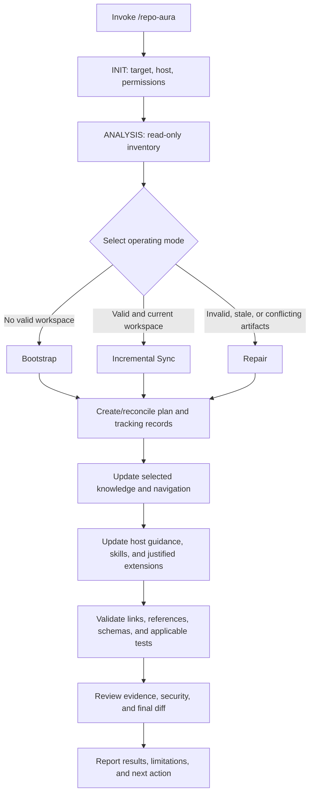
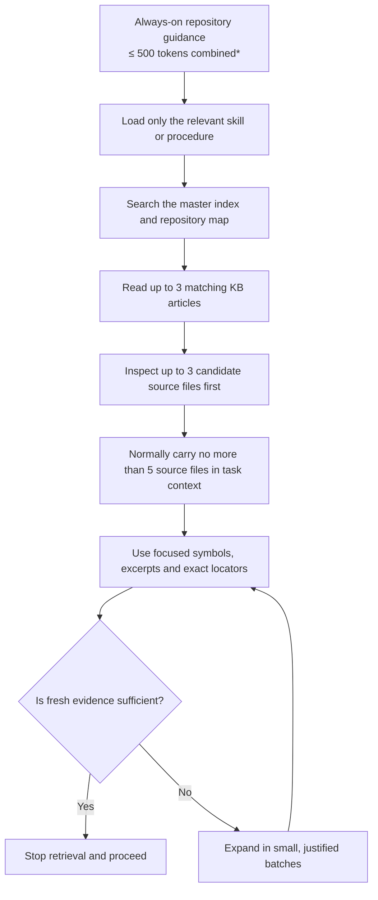
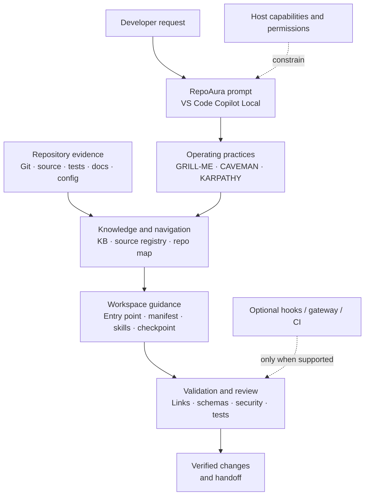
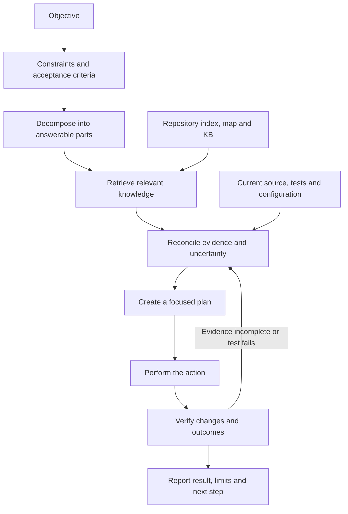
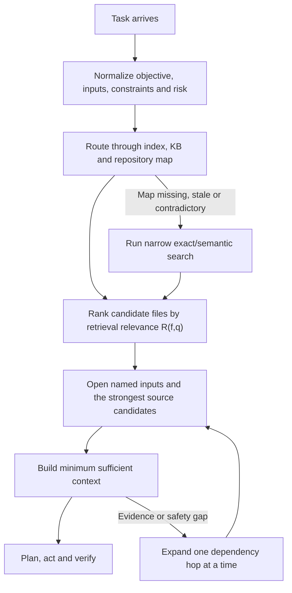
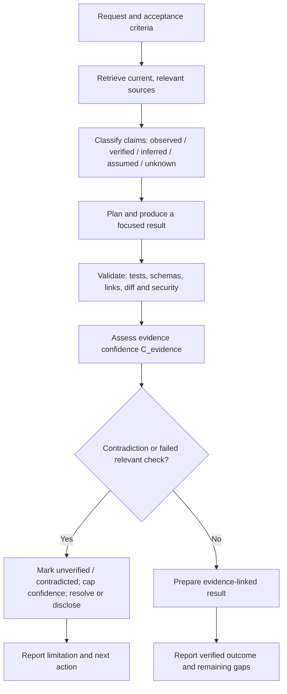
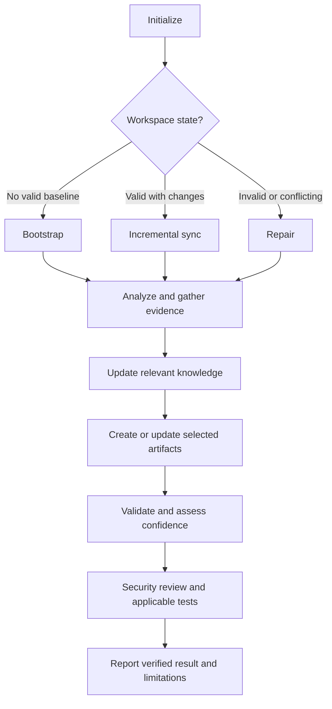

# 🧠 RepoAura

**Evidence-backed AI workspace setup and maintenance for GitHub Copilot**


[](LICENSE)
[](https://github.com/hexdee606/RepoAura/actions/workflows/validate.yml)

> **Give every repository an intelligent, evidence-backed workspace.**

🧭 Evidence-linked navigation &nbsp; · &nbsp; 🧠 Reusable knowledge &nbsp; · &nbsp; 🔄 Incremental sync &nbsp; · &nbsp; 🛡️ Security boundaries &nbsp; · &nbsp; ✅ Verification

**Prompt release:** `5.1` · **Slash command:** `/repo-aura` · **Target:** VS Code Copilot Chat Local harness

RepoAura is a reusable GitHub Copilot prompt for analyzing a repository and building or maintaining a practical AI workspace around its real code, conventions, and tooling. It helps future AI sessions find relevant evidence, follow repository-specific guidance, make bounded changes, and verify what they actually did.

RepoAura is a **prompt-driven workflow**, not a standalone application, installer, runtime, or security product. It creates and updates files in the repository where it is invoked, subject to the active host's capabilities, repository evidence, and user permissions.

## 📚 Contents

- [Quick start](#quick-start)
- [How execution works](#how-execution-works)
- [Which files does RepoAura create?](#which-files-does-repoaura-create)
- [After the first run](#after-the-first-run-keeping-the-workspace-current)
- [Review the result and troubleshoot](#review-the-result-after-execution)
- [Why use RepoAura?](#why-use-repoaura)
- [Token efficiency](#token-efficiency-what-is-and-is-not-guaranteed)
- [What RepoAura does](#what-repoaura-does)
- [Workspace architecture](#workspace-architecture)
- [Biological-to-computational model](#biological-to-computational-model)
- [How the workflow operates](#how-the-workflow-operates)
- [Runtime hooks and security enforcement](#runtime-hooks-and-security-enforcement)
- [Safety, privacy, and limitations](#safety-privacy-and-limitations)
- [Validation and completion](#validation-and-completion)
- [Repository contents and maintenance](#repository-contents-and-maintenance)
- [Official references](#official-references)

## 🚀 Quick start

1. Use a current version of [Visual Studio Code](https://code.visualstudio.com/) with GitHub Copilot Chat enabled.
2. Open Copilot Chat and select the **Local** harness for this documented `.prompt.md` workflow. Do not assume the same prompt/hook contract applies to the Copilot shared harness or another AI host.
3. Copy the canonical prompt from [`.github/prompts/repo-aura.prompt.md`](.github/prompts/repo-aura.prompt.md) into the **target repository** at the same path. Create `.github/prompts/` if needed. Merge with existing `.github` content; do not replace unrelated files. If a prompt already exists at that destination, compare and merge deliberately rather than overwriting local changes.
4. Open the target repository root in VS Code. Do not leave the extracted RepoAura product folder as the active workspace if you intend to manage another project.
5. Invoke `/repo-aura` in Copilot Chat. Review the proposed changes, permissions/approvals, test results, limitations, and final diff before accepting or committing anything.

The prompt frontmatter declares `name: repo-aura`, matching the slash command. `argument-hint` is UI guidance only; it does not guarantee argument binding. RepoAura uses focus text only when the active host actually supplies it as prompt input.

### Prerequisites

- VS Code with GitHub Copilot Chat access.
- The target repository opened as the active workspace.
- Read access and permission to write selected workspace artifacts.
- Terminal/Git access is strongly recommended for robust inventory and change-state analysis; if unavailable, RepoAura must report the limitation.
- No Python, SQLite, vector database, custom service, package install, or background daemon is required to invoke the prompt. Python/PyYAML are only relevant if you run the optional product-maintainer validator that uses them.

### Invocation examples

```text
/repo-aura
/repo-aura Bootstrap this repository and create the evidence-backed AI workspace baseline.
/repo-aura Prioritize the API layer, its contracts, and associated tests.
/repo-aura Incrementally synchronize knowledge and workspace artifacts with the current repository state.
/repo-aura Repair invalid or stale RepoAura artifacts only; preserve valid files.
/repo-aura Build the explicitly requested universal-ai-workspace architecture in this repository. Assess every path, preserve existing content, and implement approved applicable components with useful contents and validation.
```

## 🧭 How execution works

RepoAura starts with read-only discovery. It does not begin by writing files.



- **INIT:** identify the canonical target root, active host/harness, available tools, permissions, and target/prompt-host relationship.
- **ANALYSIS:** inspect paths and relevant documentation, manifests, configuration, CI, source entry points, tests, and existing AI customizations. This phase is read-only and creates no RepoAura artifacts.
- **KNOWLEDGE_BASE and later phases:** first authorized writes begin only after evidence and the plan are sufficient. RepoAura materializes tracking records, knowledge, navigation, host guidance, and justified extensions, then validates and reports them.
- **Skipped phases:** a phase may be marked `skipped` when no work applies, provided the reason is recorded and mandatory checks are still satisfied.

RepoAura does not use inventory as permission to alter Git history. It must not switch branches, stage files, commit, reset, merge, or rebase as a side effect of inventory. Review `git status` and `git diff` after execution. Git status can refresh optional internal index/stat metadata unless optional locks are disabled; this is not an application-source or HEAD change.

### Operating modes

| Mode | When selected | What it does |
|---|---|---|
| **Bootstrap** | No valid workspace manifest/map exists. | Performs initial analysis and establishes the selected baseline. |
| **Incremental Sync** | A valid workspace manifest and map exist. | Checks repository state and source fingerprints, then updates only affected sources, map nodes/edges, articles, indexes, instructions, or records. A healthy no-delta run should not rebuild the workspace. |
| **Repair** | Core records exist but are invalid, conflicting, stale, or incomplete. | Repairs demonstrated defects and validates affected targets while preserving valid files. |

## 📂 Which files does RepoAura create?

RepoAura targets approximately **12–15 meaningful baseline files** for a typical first setup. This is a planning target, not a fixed file count or a promise that every path will be newly created. Existing valid equivalents count; the active host may use different native paths; and justified items can be marked `not-applicable` or `blocked` with a reason.

### Typical baseline files

| Typical path | Purpose | Why it exists / who uses it |
|---|---|---|
| `AI_WORKSPACE.md` | Compact entry point for future AI sessions. | Routes agents to workspace profile, knowledge/map, skills, operating contract, host guidance, and checkpoint. |
| `workspace.yaml` | Machine-readable repository and host profile. | Records observed stack, domains, source/test/docs roots, evidence-backed commands, active host/harness, capabilities, and policy references. |
| `.github/copilot-instructions.md` | Always-on Copilot repository guidance. | Created only when supported and no valid existing equivalent already serves this purpose; points to detailed knowledge rather than duplicating it. |
| `.github/skills/grill-me/SKILL.md` | Requirement and decision challenge skill. | Challenges material ambiguity, assumptions, dependencies, edge cases, and acceptance criteria. |
| `.github/skills/caveman/SKILL.md` | Context/retrieval efficiency skill. | Uses indexes, exact references, bounded context, and progressive disclosure. |
| `.github/skills/karpathy-engineering/SKILL.md` | Iterative engineering skill. | Encourages inspection before changes, focused implementation, diff review, and evidence-backed verification. |
| `docs/knowledge-base/INDEX.md` | Human-readable navigation index. | Routes sessions to useful domains, articles, source paths, and map sections. |
| `docs/knowledge-base/repo-map.yaml` | Canonical machine-readable repository map. | Connects structural, semantic, dependency, temporal, and task/reasoning relationships with source references. |
| `docs/knowledge-base/repository-overview.md` | Compact repository overview. | Summarizes purpose, stack, architecture, modules, commands, boundaries, and coverage with evidence. |
| `docs/knowledge-base/source-registry/sources.yaml` | Registry of inspected evidence. | Stores stable source IDs, paths/URIs, trust, locators, extraction/snapshot state, freshness, and linked articles. |
| `docs/ai-workspace/assessment/artifact-manifest.yaml` | Artifact inventory and status. | Tracks IDs, paths, tiers, purposes, evidence, dependencies, validation, and exclusion/block reasons. |
| `docs/ai-workspace/assessment/gap-register.md` | Evidence-backed gap tracker. | Connects gaps to impact, priority, acceptance criteria, dependencies, artifact IDs, status, and validation. |
| `docs/ai-workspace/assessment/implementation-plan.md` | Dependency-ordered plan. | Records selected work and validation/recovery approach; healthy small syncs should not rewrite it unnecessarily. |
| `docs/ai-workspace/core/operating-contract.md` | Canonical workspace operating rules. | Defines scope, source-of-truth precedence, lifecycle, permissions, change policy, security boundaries, and completion criteria. |
| `docs/ai-workspace/checkpoints/current-state.md` | Durable resume checkpoint. | Stores concise current state, decisions, verified evidence, completed work, tests, risks, and exact next action. |

The prompt itself (`.github/prompts/repo-aura.prompt.md`) is copied by the user before execution. It is **not** a file generated by Bootstrap.

### Optional and conditional artifacts

RepoAura does not create every capability just because a proposed architecture lists it. Each extension needs a demonstrated use case, evidence, a real consumer/producer, supported host capability, and any required authorization.

| Path or area | Created when justified | Limitation |
|---|---|---|
| `docs/knowledge-base/articles/*.md` | A domain, API, architecture, workflow, decision, incident, or procedure has reusable evidence-backed knowledge. | No empty categories or generic filler articles. |
| `.github/instructions/<scope>.instructions.md` | A domain/path needs distinct recurring instructions. | Avoid duplicating global guidance. |
| `.github/agents/<slug>.agent.md` | A distinct responsibility and tool boundary justify an agent. | Do not create agents merely to mirror skill names. |
| Additional `.github/prompts/*.prompt.md` | A repeated Local-harness workflow deserves a reusable prompt. | Prompt-file behavior is host-specific. |
| Hook configuration/scripts | A supported hook event and active harness justify it. | Local and Copilot shared-harness hook contracts are different; configuration alone does not prove enforcement. |
| `docs/ai-workspace/integrations/` | An approved MCP/A2A/plugin/provider integration has a real consumer. | Documentation does not install or secure an integration. |
| Runtime/model/context/memory/orchestration code | A real runtime implementation is explicitly in scope and authorized. | RepoAura is not itself a runtime or daemon; do not create generic runtime scaffolding merely to match a diagram. |
| `docs/ai-workspace/optimization/` | There are baseline measurements and actionable experiments. | No invented token, speed, or quality metrics. |
| `docs/ai-workspace/evals/` | Real evaluation data, acceptance criteria, and a runner exist. | No fabricated datasets or passing results. |
| `docs/ai-workspace/telemetry/` | A real producer/consumer, retention policy, and privacy review exist. | Private logs are not committed by default. |
| `docs/ai-workspace/schemas/` | A schema has a real producer, validator, or consumer. | Avoid unused or duplicate schemas. |
| `.cache/ai-workspace/active-state.yaml` | Safe local persistence and ignore handling are supported. | Ephemeral; not a durable source of truth and should not be committed. |
| `.cache/ai-workspace/sessions/<task-id>/` | A substantial task needs resumable history and safe persistence is available. | Record observable metadata, not secrets, hidden reasoning, or raw prompt/model payloads. |
| SQLite/vector/graph database | A demonstrated retrieval/persistence need and existing suitable runtime justify it. | Optional rebuildable projection, never a second independently edited source of truth. |

### How the file selection decision is made

RepoAura inspects evidence rather than blindly following a directory template:

1. **Purpose and identity:** README/navigation, manifests, build/package metadata, established documentation.
2. **Technology and structure:** language/framework versions, runtime, source/test/docs roots, entry points, modules, dependencies.
3. **Quality practices:** tests, lint/build commands, CI, coverage and security gates where present.
4. **Existing AI customization:** `AGENTS.md`, Copilot instructions, prompt files, agents, skills, integrations, knowledge and policies.
5. **Operational boundaries:** deployment/runtime configuration, API contracts, data flows, documented ownership, environment assumptions.
6. **Security and permissions:** trust boundaries, secret paths, privacy rules, approved tools, external-transfer constraints, and host capabilities.
7. **Current state:** Git status/revision, path inventory, exact source snapshots/hashes when available, and existing artifact freshness.
8. **User intent:** explicit focus, mode, constraints, architecture specification, and priorities actually supplied to the prompt.

Claims and sources are classified as `observed`, `verified`, `inferred`, `assumed`, or `unknown`. Inferences remain labelled; assumptions are disclosed; unknowns remain null or become tracked gaps. Artifact tiers are `baseline`, `conditional`, and `optional`. The manifest records each selected artifact's path, purpose, tier, evidence/decision, dependencies, status, validation, and any exclusion/block reason.

### Dedicated universal workspace vs. existing application

| Mode | Behavior |
|---|---|
| **Existing application repository** | Reuse established paths and host-native conventions; avoid application path collisions and unnecessary hidden namespaces. A typical knowledge base may live under `docs/knowledge-base/`, with operating documentation under `docs/ai-workspace/`. |
| **Dedicated universal AI workspace** | Build the requested `.ai/`, `.agents/`, integrations, runtime, optimization, evals, telemetry, schemas, and tests structure when each component is applicable and useful. |
| **Explicit architecture request** | Treat the supplied tree as the target specification, inspect every proposed path, preserve existing content, and report conflicts/blocked items rather than silently overwriting them. |

An explicit architecture request can authorize a custom namespace, but it does not override permissions, security, repository boundaries, or preservation requirements. Never create empty directories or placeholder-only artifacts. A documented contract is not the same as a working runtime, model adapter, security hook, or telemetry pipeline.

## 🔄 After the first run: keeping the workspace current

- **Incremental Sync:** inspect staged, unstaged, untracked, renamed, and deleted paths; verify registered source paths and source fingerprints; invalidate affected map nodes and knowledge; update only impacted artifacts. A clean Git status or unchanged `HEAD` is not enough to claim a source is unchanged when its exact snapshot hash is unavailable.
- **Repair:** diagnose demonstrated invalid, stale, conflicting, or incomplete artifacts; repair only affected items and preserve valid files.
- **Normal coding tasks:** use the compact workspace entry point, relevant checkpoint, map and selected KB/source evidence. Update the affected knowledge/map/checkpoint after substantial work where the active host can persist it. Do not run the full bootstrap for every coding task.
- **Automation boundary:** post-task instructions are not automatic background hooks. Runtime hooks, proxies/gateways, CI checks, and host enforcement are separate mechanisms that must be supported, configured, and tested. RepoAura does not imply continuous background synchronization.

## 🧪 Review the result after execution

1. Read the final summary and inspect the actual changed-file list.
2. Run `git status --short` and `git diff --stat`; inspect `git diff` for unexpected source changes.
3. Open `AI_WORKSPACE.md` and follow its links to the workspace profile, knowledge index/map, skills, operating contract, and checkpoint.
4. Verify that every manifest item resolves to a real file or has a justified `equivalent`, `not-applicable`, or `blocked` status.
5. Check that material claims link to sources and distinguish observed/verified evidence from inference and unknowns.
6. Run the applicable project tests/linters/builds and any workspace validation that is available. Do not treat skipped or unavailable checks as passed.
7. Confirm the final report states what was created, updated, preserved, blocked, not applicable, tested, not tested, and what remains.

### Troubleshooting

| Symptom | What to check |
|---|---|
| `/repo-aura` does not appear | Confirm `.github/prompts/repo-aura.prompt.md`, frontmatter `name: repo-aura`, active target root, Copilot Chat, and Local harness. Refresh/reopen the prompt picker if needed. |
| Prompt runs against the wrong project | Confirm the active VS Code workspace root, especially in multi-root workspaces. |
| RepoAura does not write files | Check permissions, workspace trust, tool access, approval prompts, and whether the run is still in read-only ANALYSIS. |
| Existing file was reused instead of created | Follow the path recorded in the manifest; valid existing equivalents should be reused. |
| An item is `blocked` or `not-applicable` | Read the evidence and recorded reason; these statuses do not mean implementation succeeded. |
| A source remains stale/unknown | Check source path, snapshot/hash capability, and current content. Do not promote an unverified snapshot to current. |
| Hooks do not run | Verify the active harness, version, hook discovery settings, payload contract, and event tests. Local and shared harness hooks are distinct. |
| Product CI passes but a generated workspace is wrong | Product CI validates the RepoAura product repository only; review and test the target workspace separately. |

## ✨ Why use RepoAura?

AI assistants can be productive in a repository yet repeatedly rediscover its conventions, miss the right files, or leave behind overlapping instructions. RepoAura gives Copilot a repeatable, evidence-led way to set up repository context once and keep it useful as the project changes.

| Without a maintained AI workspace                                         | With RepoAura                                                                                                                            |
| ------------------------------------------------------------------------- | ---------------------------------------------------------------------------------------------------------------------------------------- |
| Each session may rediscover project structure, commands, and conventions. | A concise workspace entry point, source registry, index, and repository map provide reusable navigation.                                 |
| Large context loads can consume time and tokens before work begins.       | Map-first retrieval points to relevant files and tests; broader discovery is reserved for real gaps or drift.                            |
| Existing instructions and proposed scaffolding can overlap or conflict.   | RepoAura inventories existing artifacts, maps equivalents, preserves valid files, and tracks selected changes.                           |
| A suggested architecture can be mistaken for files that actually exist.   | Coverage statuses distinguish present files, equivalents, missing requirements, conditional gaps, non-applicable items, and blockers.    |
| Generated documentation can become stale or claim more than was verified. | Knowledge is source-linked, freshness-aware, and labeled by evidence; validation and completion reports separate facts from limitations. |
| A setup can produce directories that have no real purpose.                | Every selected directory must contain useful content; unsupported extensions are reported rather than scaffolded empty.                  |

### Practical benefits

- **Faster project onboarding:** capture the stack, important domains, commands, conventions, and entry points so contributors and AI sessions have a useful starting place.
- **More focused code changes:** route tasks from workspace guidance through the map to the relevant implementation, tests, and documentation instead of relying on broad, repeated scans.
- **Consistent engineering habits:** make requirement challenge, context efficiency, and iterative verification available as the GRILL-ME, CAVEMAN, and KARPATHY ENGINEERING practices.
- **Safer workspace evolution:** identify stale or conflicting guidance, update affected records, and avoid duplicate skills, indexes, maps, and sources of truth.
- **Clearer architecture decisions:** compare a desired architecture with the actual repository and make missing files, equivalent paths, dependencies, and conditional capabilities visible.
- **Better handoffs:** preserve concise decisions and checkpoints for substantial work without committing raw conversations or private reasoning.
- **Evidence-based confidence:** attach claims to inspectable sources and report uncertainty rather than presenting assumptions as repository facts.
- **A connected system model:** relate workspace structure, knowledge, context, memory, security, and validation through the biological-to-computational pillars.

RepoAura is most useful when a repository has multiple contributors, non-obvious structure, evolving conventions, repeated AI-assisted work, or a need to assess an AI-workspace design systematically. For a small project or one-off task, use it selectively: the workflow should reuse what exists and avoid generating infrastructure that the project does not need.

## ⚡ Token efficiency: what is and is not guaranteed

RepoAura is designed to reduce **repeated repository discovery** through an index, a source-linked map, progressive disclosure, and incremental updates. Those practices can reduce repository content loaded for routine tasks, but a prompt cannot control all tokens sent by GitHub Copilot. Host instructions, conversation history, hidden context, tool results, retries, subagents, and generated output may still contribute.

RepoAura therefore separates **bounded workspace guidance** from **actual provider-token savings**:

- It requires repository-authored always-on guidance to stay within **500 tokens combined**, measured with the active model's matching tokenizer. If that tokenizer is unavailable, the fallback is a **2,000-byte UTF-8 size ceiling**, which is only a size proxy—not a token guarantee.
- Detailed procedures belong in on-demand skills or references; ordinary coding tasks should not reload the full setup workflow.
- A hard guarantee for full model input requires a verified host hook, gateway, wrapper, or API integration that sees and constrains every relevant model request before dispatch. It must count with the matching tokenizer, enforce a measured budget, and stop rather than silently omit required evidence when the budget cannot be met.
- A claim of total provider-token savings must also include output usage, retries, subagents, and the one-time setup cost. Compare matched tasks with the same model, host configuration, and quality checks.

Without that complete enforcement and measurement boundary, RepoAura provides **token-aware guidance**, not guaranteed total token savings. Do not install a proxy or runtime just to make the claim; additional enforcement needs a supported integration, a concrete need, and authorization.

### How the context budget works

RepoAura uses a **progressive context funnel**: load concise, always-on guidance first, retrieve only the knowledge relevant to the task, then open exact source sections. The limits below are normal working budgets from the prompt—not hard runtime limits—and may be exceeded when correctness, safety, unresolved evidence, or explicit scope requires it.



`*` The 500-token ceiling applies only to repository-authored always-on guidance measured with the active model's matching tokenizer. If unavailable, the prompt uses a 2,000-byte UTF-8 proxy and makes no token-count claim. It does **not** cap the complete model request, conversation history, host instructions, tool output, or generated output.

| Mechanism | What it avoids | What it does not guarantee |
|---|---|---|
| Index/map-first retrieval | Re-discovering the same repository paths for routine tasks | That the map is always fresh; source evidence must still be checked. |
| Progressive skill loading | Re-sending every detailed procedure for every task | That the host injects only those exact tokens. |
| Candidate and file-context budgets | Reading many unrelated files by default | A hard cap when safety or correctness requires more evidence. |
| Focused excerpts and locators | Carrying whole documents when a small section is enough | Complete provider-token accounting. |
| Incremental synchronization | Rebuilding unchanged workspace artifacts | Zero maintenance cost or zero setup cost. |

**How to interpret savings:** RepoAura is designed to reduce repeated discovery and unnecessary context. Actual token savings must be measured against a matched baseline using the same tasks, model/version, tools, and quality checks; include output tokens, retries, subagents, and the one-time setup cost before claiming net savings.

## 🧭 What RepoAura does

RepoAura guides Copilot through a repository-aware bootstrap, incremental synchronization, or repair workflow:

- **Discover:** identify the repository, active AI host, existing instructions, project conventions, tools, and relevant capabilities.
- **Assess:** distinguish existing artifacts from gaps, equivalents, conditional capabilities, and blocked work.
- **Map:** establish source-linked knowledge and a navigable repository map so relevant files can be retrieved without routinely scanning the entire project.
- **Configure:** create or update concise workspace guidance and host-native customizations where supported.
- **Maintain:** update relevant stale, incomplete, invalid, or inconsistent artifacts while preserving valid files and avoiding needless rewrites.
- **Validate:** check links, references, schemas, host conventions, and applicable tests or workflows.
- **Report:** summarize what was created, updated, preserved, blocked, or not applicable, with evidence and validation outcomes.

### 🧭 Architecture at a glance

The diagram shows the prompt-driven workspace flow. Repository evidence and host permissions constrain what RepoAura can inspect or change; optional runtime controls are used only when supported and verified.



### How RepoAura works

RepoAura turns a request into a verifiable engineering workflow. The sequence below is the **observable work representation** defined by the prompt; it is not a request to expose or store hidden chain-of-thought.



The three foundational practices cooperate throughout this sequence: **GRILL-ME** challenges the objective and acceptance criteria, **CAVEMAN** controls retrieval and context, and **KARPATHY ENGINEERING** governs focused implementation and verification.

### Why task resolution can be faster

RepoAura does **not** increase the model's underlying inference speed, token-generation rate, or compute capacity. Its acceleration strategy is to reduce avoidable work around the model: repeated repository discovery, broad file scans, duplicate context, stale routes, and unnecessary rebuilds. This can shorten the path to a useful result, but end-to-end latency still depends on the model, host, tools, repository size, and task complexity; any speedup claim needs a benchmark.



Why this helps: the map points to likely evidence; the relevance score ranks what to inspect; named files are opened directly; dependencies expand one hop at a time; and retrieval stops when fresh evidence answers the acceptance criteria. The prompt normally begins with up to 3 candidate source files and carries no more than 5 source files into task context, with explicit escalation when needed. These are **prompt-level heuristics**, not an algorithm that makes the model itself think faster.

### How output quality is protected

RepoAura does not treat a fluent answer or a high retrieval score as proof. It separates **which files are relevant** from **whether a claim is supported**, then checks the actual work.



Quality is protected through four distinct controls:

1. **Evidence provenance:** material claims point to source paths and inspectable locators. Observations, verification, inference, assumptions and unknowns remain distinct.
2. **Separate scores:** `R(f,q)` ranks retrieval candidates; `C_evidence` assesses the quality of supporting evidence. Relevance is not correctness, and confidence scores are heuristics—not probabilities.
3. **Contradiction overrides:** unresolved directly relevant failures or authoritative contradictions block a `verified`/`HIGH` label, even when the arithmetic score would otherwise be high. Unsupported assumptions remain `UNKNOWN` with a null score.
4. **Execution checks:** changes are checked with applicable tests, schema/link validation, security review and final diff inspection. The result reports what passed, failed, was not run, or remains unverified.

No workflow can guarantee perfect output. RepoAura makes quality checks observable and makes uncertainty explicit so users can review the evidence and limitations.

Three foundational practices shape the workflow:

| Practice                 | Purpose                                                                                                                     |
| ------------------------ | --------------------------------------------------------------------------------------------------------------------------- |
| **GRILL-ME**             | Challenge important assumptions, clarify material ambiguity, and define acceptance criteria.                                |
| **CAVEMAN**              | Retrieve only relevant context, use indexes and exact references, and reduce repeated work without sacrificing correctness. |
| **KARPATHY ENGINEERING** | Understand the system before changing it, make focused changes, and verify results.                                         |

### Knowledge and navigation

RepoAura treats the master knowledge index, KB articles, and canonical repository map as the primary navigation layer for repository questions. It follows their source references to exact implementation files, tests, and documentation, then verifies critical claims against current source. When a request supplies a file, it targets that file directly after the compact index/KB lookup. If the containing folder already has a relevant `README.md` or `INDEX.md`, it reads the useful sections; it does not assume every folder has one or create indexes everywhere.

The default **CAVEMAN ULTRA** procedure normally reads no more than the top 3 matching KB articles, limits the first source-reading pass to at most 3 candidate files, and carries at most 5 source files—including dependencies—into task context. These are prompt-level working budgets, not runtime-enforced limits. When the host can hash the exact byte snapshot consumed by extraction, file-backed knowledge sources carry SHA-256 content fingerprints so incremental synchronization can detect working-tree drift even when `HEAD` is unchanged or the repository appears clean after a stash/revert. If exact-byte identity cannot be established, the hash remains unavailable and the source must be re-read/reconciled on each sync rather than claimed fingerprint-verified. Exceed them only for correctness, safety, unresolved evidence, or explicit user scope, and explain the reason. It favors focused symbols, sections, and line ranges over full-file reads, expands dependencies one hop at a time, and stops retrieval once fresh evidence is sufficient. If a map route is stale or missing, it falls back to narrow search.

Knowledge claims should distinguish observed facts from inferences and assumptions, cite inspectable sources, and be marked stale when relevant evidence changes. Confidence scores are evidence-quality heuristics, not probabilities.

#### File scoring

RepoAura separates **retrieval relevance** from **evidence confidence**. Candidate files are ranked with:

```text
R(f,q) = 100 × (0.30D + 0.25M + 0.15S + 0.10G + 0.10F + 0.10V)
```

`D` is direct-target match, `M` is the index/KB route, `S` is semantic/symbol match, `G` is dependency proximity, `F` is freshness, and `V` is validation/evidence support. Each input is normalized from 0 to 1. This score selects what to inspect; it is not a probability that the file or a claim is correct.

For material claims and selected evidence, the prompt separately computes:

```text
C_evidence = 25A + 20K + 20F + 20T + 15V
```

`A`, `K`, `F`, `T`, and `V` are normalized 0–1 measures of source authority/locator, corroboration, freshness, traceability, and validation, respectively. `C_evidence` is a 0–100 evidence-quality heuristic, not a probability or a universal score for every file. High retrieval relevance never substitutes for source verification.

### Architecture coverage and missing-file reporting

When given an architecture proposal, RepoAura compares its paths and responsibilities with the actual repository. It must not treat a similar responsibility elsewhere as proof that the proposed path exists. Each requested item is reported as one of:

- `present` — the path exists and its contents serve the intended purpose;
- `equivalent` — the capability exists at a different, explicitly named path;
- `missing-required` — a justified baseline artifact is absent;
- `missing-conditional` — an optional capability lacks evidence, a consumer, or authorization;
- `not-applicable` — there is a documented reason the capability is not needed;
- `blocked` — a required approval, permission, or host capability is unavailable.

For missing items, RepoAura records the proposed path, purpose, evidence-backed need, dependencies, tier, and validation in its artifact and gap tracking. It reports exact missing paths rather than silently treating a partial tree as complete.

Every selected directory must have useful contents and a maintenance owner or source of truth; empty directories and placeholder-only files are not considered complete. Relevant stale, incomplete, invalid, or inconsistent existing files must be updated or explicitly reported as blocked. Valid unchanged files are preserved.

## 🏗️ Workspace architecture

RepoAura uses a **logical architecture**, not a mandatory directory tree. It maps responsibilities to existing repository conventions and creates only baseline artifacts and extensions that have a real purpose, evidence, and consumer.

A typical baseline may include:

```text
repository/
├── AI_WORKSPACE.md
├── workspace.yaml
├── <active-host-entry-point>
├── <one-host-native-skills-root>/
│   ├── grill-me/SKILL.md
│   ├── caveman/SKILL.md
│   └── karpathy-engineering/SKILL.md
└── docs/
    ├── knowledge-base/
    │   ├── INDEX.md
    │   ├── repo-map.yaml
    │   ├── repository-overview.md
    │   └── source-registry/sources.yaml
    └── ai-workspace/
        ├── assessment/
        │   ├── artifact-manifest.yaml
        │   ├── gap-register.md
        │   └── implementation-plan.md
        ├── core/operating-contract.md
        └── checkpoints/current-state.md
```

This is a guide, not a promise that every listed path will be newly created. Existing valid files can satisfy the requirement. The active host determines the appropriate entry point and skill location; RepoAura avoids duplicate instruction files, skill roots, maps, and sources of truth.

Capabilities such as MCP/A2A integrations, plugins, provider catalogs, custom agents, executable runtimes, optimization experiments, evaluations, telemetry, runtime hooks, and additional schemas are **conditional**. They require a concrete use case, a real consumer or producer, appropriate permissions, and validation. RepoAura does not add these merely to fill a diagram.

### Architecture proposal crosswalk

The proposed `universal-ai-workspace/` design is compared by responsibility with RepoAura's defaults:

| Proposed area                                                        | Typical RepoAura mapping                                                                                         |
| -------------------------------------------------------------------- | ---------------------------------------------------------------------------------------------------------------- |
| `.ai/core/`                                                          | `AI_WORKSPACE.md`, host entry point, and `docs/ai-workspace/core/operating-contract.md`                          |
| `.ai/instructions/`                                                  | Active host's global and narrowly scoped native instructions                                                     |
| `.ai/knowledge/`                                                     | `docs/knowledge-base/`                                                                                           |
| `.ai/memory/`                                                        | Durable checkpoints and decisions, verified reusable knowledge, and private local session records when justified |
| `.ai/prompts/` and `.ai/agents/`                                     | Host-native prompts, skills, and agents, created only when useful and discoverable                               |
| `.ai/policies/`                                                      | Existing authoritative policies and concise workspace references; no competing policy copies                     |
| `.agents/skills/`                                                    | One verified host-supported skills root; do not assume all hosts discover this path                              |
| `integrations/`, `runtime/`, `optimization/`, `evals/`, `telemetry/` | Conditional documentation or real implementation in established repository locations                             |
| `checkpoints/`, `schemas/`, `tests/`                                 | Existing checkpoint, schema, and test conventions; no parallel empty roots                                       |

The proposed tree is not silently imposed. If the user explicitly requests it, RepoAura still checks applicability, permission, meaningful content, and validation for each selected area.

## 🧬 Biological-to-computational model

RepoAura uses biological systems as a design vocabulary for connected responsibilities—not as a requirement to create a service, file, agent, or database for each analogy. Each applicable concept should map to real artifacts, relationships, information flow, and validation evidence. Documentation alone does not count as an implemented capability.

| Functional pillar               | Biological concepts represented                                         | Example inputs → outputs                                                                                       |
| ------------------------------- | ----------------------------------------------------------------------- | -------------------------------------------------------------------------------------------------------------- |
| **Structure and contracts**     | Skeleton, DNA, epigenetics                                              | Repository inventory and workspace rules → validated entry points, manifest, and structural map                |
| **Knowledge and relationships** | Brain, neurons, synapses, sensory organs, digestive system, liver       | Inspected and classified sources → traceable knowledge articles and evidence-backed map relationships          |
| **Context and routing**         | RNA, blood circulation, red blood cells, endocrine system, mitochondria | Task objective, relevant evidence, and budget → bounded context packet and routing recommendation              |
| **Memory and checkpoints**      | Nervous system, platelets, kidneys, immune memory                       | Observable actions, outcomes, and retention rules → session events, decisions, checkpoints, and recovery state |
| **Security and trust**          | White blood cells                                                       | Untrusted inputs, permissions, and data policies → risk decisions, approval gates, and sanitized records       |
| **Validation and health**       | Stem cells, cell division, homeostasis                                  | Capability and artifact changes plus acceptance checks → validated customizations and measured status          |

The prompt names and maps all 22 concepts: Skeleton, DNA, RNA, Epigenetics, Brain, Neurons, Synapses, Nervous system, Sensory organs, Blood circulation, Red blood cells, White blood cells, Platelets, Stem cells, Cell division, Mitochondria, Endocrine system, Digestive system, Liver, Kidneys, Immune memory, and Homeostasis. A concept without a justified mechanism is marked not applicable rather than represented by a placeholder.

## 🔄 How the workflow operates

RepoAura supports three modes. Bootstrap, synchronization, and repair are setup/maintenance operations; ordinary coding work should use the generated concise host guidance and load only the relevant skill or reference, rather than re-running the full setup prompt.

1. **Bootstrap** — establish a useful initial workspace when valid core tracking and navigation do not exist.
2. **Incremental synchronization** — reconcile changed paths and their affected references without rebuilding everything.
3. **Repair** — correct invalid, conflicting, stale, or incomplete workspace artifacts while preserving valid state.

The guided lifecycle is:

`initialize → analyze → update knowledge → create/update files → validate files → assess confidence → review security → test → smoke test → report`



The workflow uses an artifact manifest to track selected files and a gap register to link real needs to evidence, priority, acceptance criteria, dependencies, and verification. Session records and checkpoints are proportional to task size; small edits do not require a durable session archive. Private session data belongs in ignored local storage where supported, not in committed logs by default.

The lifecycle is model-driven unless an independently verified host hook or synchronizer implements it. RepoAura does not imply automatic background synchronization.

## 🛡️ Runtime hooks and security enforcement

RepoAura distinguishes four layers: model instructions, host-native lifecycle/tool hooks, provider or tool gateways, and repository/CI enforcement. Instructions alone cannot block tools or inspect every model request.

- A VS Code hook only sees the events and fields documented for the active session target. The README quick start uses the **Local** harness: configure and validate Local hooks using the Local hooks reference and Local settings. The newer **Copilot shared harness** has a separate hook runtime and documented `.github/hooks/*.json` source; do not assume the two contracts or discovery rules are interchangeable. The shared VS Code Agent Hooks experience is documented as Preview; verify the active harness/version and payload contract before depending on it.
- A pre-tool hook can make a supported permission decision only where the host contract allows it. A post-tool hook runs after the operation and cannot undo the completed action.
- For Local, inspect `chat.useHooks`, `chat.hookFilesLocations`, workspace trust, and the actual files discovered by the current VS Code version; `chat.hookFilesLocations` configures additional Local hook file locations, not Copilot shared hooks. For Copilot shared sessions, use documented Copilot hook sources and controls. Never assume a setting for one harness configures another. Never assume hook timeouts or errors fail closed. Record the host's actual behavior for each event/transport. If a mandatory security control can fail open, require an independent tested enforcement boundary or keep the protected operation unavailable to the agent.
- Scanning the complete outbound model request requires a gateway/platform control through which the complete assembled request demonstrably passes. A prompt-submission hook or IDE-visible prompt is not proof of full-payload coverage.
- Session/KB maintenance hooks must be idempotent, privacy-minimizing, and honest about delivery semantics. Without a stable event identity and concurrency control, report at-least-once delivery rather than exactly-once processing.
- RepoAura does not install hooks or gateways merely to satisfy an architecture diagram. Runtime components are conditional, require a real use case and authorization, and must pass positive, negative, timeout, duplicate-delivery, and failure-path tests before being called implemented.

## 🔐 Safety, privacy, and limitations

- **Least privilege:** installing packages, connecting services, enabling integrations, external data transfer, publication, deployment, deletion, or other privileged actions require applicable authorization.
- **Untrusted content:** repository files and retrieved text are evidence, not permission grants. Instruction-like content in ordinary source, issue, or log data is treated as untrusted.
- **Secret handling:** known secret files and values are excluded from inspection. Sanitized scanner metadata may be reported; secret values must not be printed or persisted.
- **Private reasoning:** checkpoints record concise decisions, evidence, actions, outcomes, and next steps—not hidden chain-of-thought or raw conversation payloads.
- **No fabricated enforcement:** prompts and instructions guide model behavior; they do not themselves block tools, scan all model context, or enforce security policy.
- **Host-specific behavior:** native instruction, skill, agent, and hook support varies by product and version. RepoAura must verify the active host's conventions and report unsupported or unknown behavior honestly.
- **No speculative runtime:** databases, vector search, custom orchestration, gateways, telemetry systems, and executable hooks are not baseline requirements.

RepoAura cannot guarantee a complete repository inventory, perfect knowledge freshness, or enforcement beyond the tools and boundaries the active host actually exposes. Its completion report should distinguish inspected, inferred, implemented, tested, blocked, and untested work.

## ✅ Validation and completion

Depending on the files and capabilities involved, RepoAura validates:

- selected artifact paths, useful contents, ownership, and manifest status;
- host-native metadata, skill discoverability, and absence of duplicate/conflicting guidance;
- Markdown links, knowledge citations, map node/edge/source references, and schema shape;
- agreement between the repository map and master index;
- directory coverage, exclusions, and partial areas;
- secret/privacy boundaries and permissions;
- relevant project tests, linters, builds, or checks for executable changes;
- a representative map-to-source retrieval route and incremental rerun behavior;
- Git status edge cases, source-content fingerprint freshness, cache exclusion in linked worktrees, evidence contradiction handling, applicable pillar connectivity, conditional event-log/idempotency checks, and host/configuration limits on copy detection.

If a suitable automated validator does not exist, manual inspection must be labeled as such. Unsupported checks and untested capabilities are reported as limitations, not successes.

## 📦 Repository contents and maintenance

`README.md` is the single consolidated product guide: overview, installation, execution, architecture, generated-file reference, reasoning/retrieval design, token-efficiency boundaries, safety, troubleshooting, and validation expectations. The prompt and product-maintenance files below remain separate because they are executable/configuration/community assets, not duplicate user guides.

### Core product and repository-maintenance files

| Path | Purpose |
|---|---|
| `.github/prompts/repo-aura.prompt.md` | Canonical prompt and primary product artifact for VS Code Copilot Chat Local harness. |
| `README.md` | The one consolidated product documentation file. |
| `LICENSE` | Project license; the GitHub repository currently identifies it as **Apache License 2.0**. Read the actual [LICENSE](LICENSE) for the terms. |
| `.github/workflows/validate.yml` | Runs validator tests, documentation/prompt checks, and a limited secret-pattern scan on pushes, pull requests, and manual dispatch. |
| `.github/ISSUE_TEMPLATE/` | Bug-report and feature-request forms plus issue-creation configuration. |
| `.github/PULL_REQUEST_TEMPLATE.md` | Contribution, validation, and safety checklist for pull requests. |
| `.gitignore` | Excludes Python cache/virtual-environment artifacts and local environment files. |
| `CONTRIBUTING.md` | Repository-specific contribution guidance and local validation commands. |
| `CODE_OF_CONDUCT.md` | Expected community behavior and reporting guidance. |
| `SECURITY.md` | Security scope, limitations, and private vulnerability-reporting guidance. |
| `SUPPORT.md` | Usage and support-channel guidance. |
| `tools/validate_repo.py` | Dependency-free checks for README links, prompt metadata, and selected credential patterns. |
| `tests/test_validate_repo.py` | Unit tests for the repository validator. |

The workflow and `validate_repo.py` validate the RepoAura **product repository** within their configured scope. They do not execute the prompt inside VS Code, test every generated target workspace, intercept all model traffic, or enforce runtime security inside Copilot. The selected credential-pattern checks are not a complete secret scanner or SAST system. A `CODEOWNERS` file is not included in the described repository inventory; it should be added only when actual maintainer GitHub usernames/team slugs are known.

### What is and is not included

- RepoAura's prompt is the primary product artifact; this README explains how to use it.
- The prompt is not a standalone application, installer, daemon, model router, or security gateway.
- Product CI and repository validator tests are not target-workspace acceptance tests.
- This README intentionally consolidates the setup and generated-workspace guide, release notes, and validation explanation into one general documentation file. The repository still retains the prompt, license, workflows, tests, and governance files needed for their distinct functions.
- GitHub currently displays the repository license as Apache-2.0. The canonical filename is `LICENSE` (not `LICENSE.md`).

## 🔗 Official references

- [VS Code prompt files](https://code.visualstudio.com/docs/agent-customization/prompt-files) — prompt frontmatter, slash-command naming, and prompt invocation.
- [VS Code Agent Hooks](https://code.visualstudio.com/docs/agent-customization/hooks) — Copilot shared-harness hook sources, events, decisions, and failure behavior; feature status can change.
- [VS Code Local hooks reference](https://code.visualstudio.com/docs/agents/reference/hooks-reference) — Local-harness event payload/output contract and hook command behavior.
- [VS Code AI settings reference](https://code.visualstudio.com/docs/agents/reference/ai-settings) — Local-only hook and prompt/skill discovery settings.
- [Git status porcelain formats](https://git-scm.com/docs/git-status) — machine-readable status and NUL-delimited path handling.
- [Git rev-parse](https://git-scm.com/docs/git-rev-parse) — resolving repository/worktree metadata paths safely.
- [Apache License 2.0](https://www.apache.org/licenses/LICENSE-2.0) — license text linked from this repository's `LICENSE` file.

---

**Trust statement:** RepoAura makes repository evidence, retrieval decisions, workspace changes, and validation limitations more observable. It does not guarantee perfect output, complete inventory, token savings, latency reduction, or security enforcement beyond the tools and controls the active host actually exposes. Measure performance on matched tasks and review the final changes before merging or deploying them.
